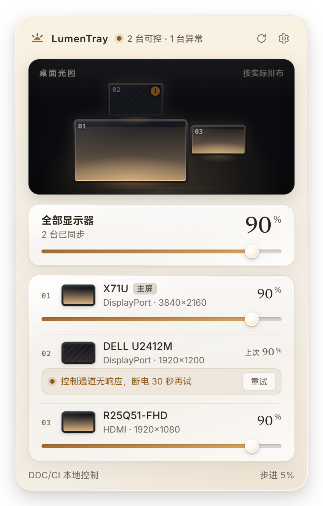

> **LumenTray 首个公开版本** · 2026-11-13

LumenTray 是为 Windows 多显示器准备的亮度托盘应用：点托盘图标、拖滑杆、关窗，就这三步。每台物理显示器通过 DDC/CI 独立控制，飞窗按真实桌面排列屏幕；应用完全本地运行，不联网、无遥测、不需要管理员权限。

<p align="center">
  
</p>

## 这个版本有什么

- **每屏独立，也能一键联动**：每块显示器一条滑杆，总控同时调整所有可读写屏幕；数值不一致时显示「混合」。
- **读不到也说得清楚**：读取失败的屏幕保留卡片，显示「上次 N%」和错误原因，其他屏幕不受影响；3 秒后自动静默重读，也可手动重试。历史值不会冒充当前亮度。
- **尽量不占资源**：启动只创建托盘，飞窗与设置窗按需创建、关闭即销毁，关窗后不保留 WebView2；拓扑变化、设备节点与睡眠唤醒由 Win32 事件触发刷新，不做常驻轮询。本机三屏实测空闲工作集约 15 MB，飞窗打开约 0.4 秒，安装包约 1.8 MB。
- **全局快捷键与 OSD**：`Alt` + `F1` / `F2` 调节所有屏幕（默认关闭，可在设置中开启并重新录制）；调节时在鼠标所在屏顶部短暂显示不抢焦点的 OSD。
- **可恢复、可诊断**：可选在启动和唤醒后恢复上次记录的亮度；设置页提供通用、快捷键、显示器、诊断、关于五页，可一键复制诊断报告。仓库另附 `ddcctl` 命令行工具用于脱离界面排查。
- **外观**：暖石墨玻璃 + 象牙光强调色，跟随系统深浅色，玻璃不透明度可调；深浅任务栏各配一套托盘图标。

## 下载

| 文件 | 说明 |
|---|---|
| `LumenTray_0.1.0_x64-setup.exe` | **推荐**。按当前用户安装，无需管理员权限，装完自动驻留托盘 |
| `LumenTray_0.1.0_x64-portable.zip` | 免安装，解压后直接运行 `lumentray.exe` |
| `SHA256SUMS.txt` | 上述两个文件的 SHA-256 校验和 |

环境：Windows 10 / 11（x64），需 WebView2 运行时（Windows 11 已自带）。

## 校验下载

下载后建议核对校验和，再运行安装包：

```powershell
$expected = (Select-String .\SHA256SUMS.txt -Pattern 'x64-setup\.exe').Line.Split()[0]
$actual   = (Get-FileHash .\LumenTray_0.1.0_x64-setup.exe -Algorithm SHA256).Hash.ToLower()
$expected -eq $actual   # 应输出 True
```

本版本安装包**未做代码签名**，Windows SmartScreen 可能提示「未知发布者」。核对 SHA-256 无误后，选择「更多信息 → 仍要运行」即可。

## 升级与常见问题

- 从 Releases 下载新版覆盖安装即可，设置、亮度记录与开机启动配置会保留；当前版本不含自动更新。
- Windows 11 可能把新托盘图标折叠到任务栏 `^` 溢出区，把它拖出来即可常驻。
- 显示器需在 OSD 中开启 **DDC/CI**，且连接链路要转发 DDC/CI。笔记本内屏、虚拟显示器、部分转接器 / KVM / 扩展坞会显示为「不可控」。
- 少数显示器（如部分 Dell 机型）的 DDC 通道会卡死，错误码常见为 `0xC0262582`；此时需要让显示器**彻底断电**（拔掉电源线等待约 30 秒）或重新插拔信号线，重启电脑或显卡驱动无法替代。软件已做单屏隔离与自动重读，但无法从主机侧恢复硬件通道。
- 当前只做亮度这一条路径，暂不支持对比度、色温、输入源或 HDR。

## 文档与反馈

- [README](https://github.com/Mornstic/lumentray#readme) · [架构详解](https://github.com/Mornstic/lumentray/blob/main/docs/architecture.md) · [设计语言](https://github.com/Mornstic/lumentray/blob/main/docs/design-language.md)
- 遇到问题请按 [Issue 模板](https://github.com/Mornstic/lumentray/issues/new/choose) 提交，附 Windows 版本、显示器型号、连接方式与设置页「诊断」中的报告；请勿粘贴未打码的完整设备路径或截图。

---

完整变更日志：[v0.1.0 提交记录](https://github.com/Mornstic/lumentray/commits/v0.1.0) · [CHANGELOG.md](https://github.com/Mornstic/lumentray/blob/main/CHANGELOG.md)
