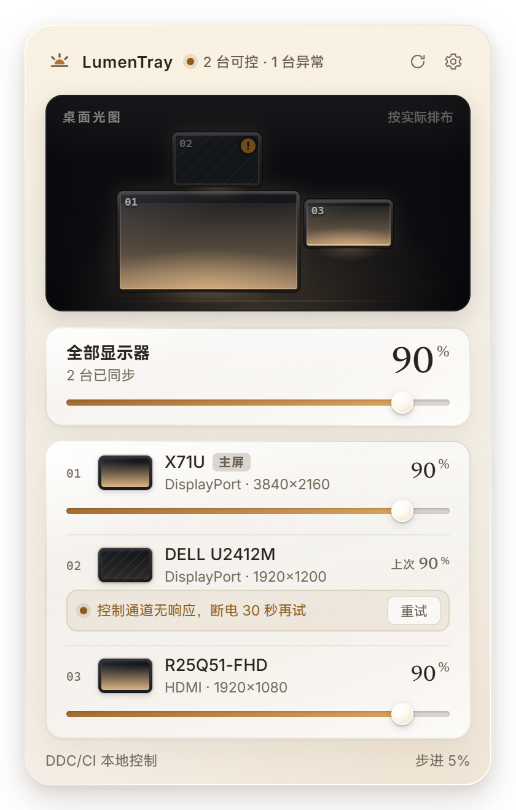
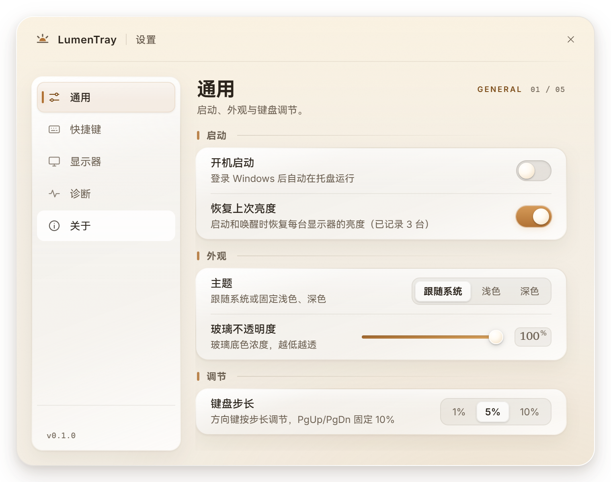
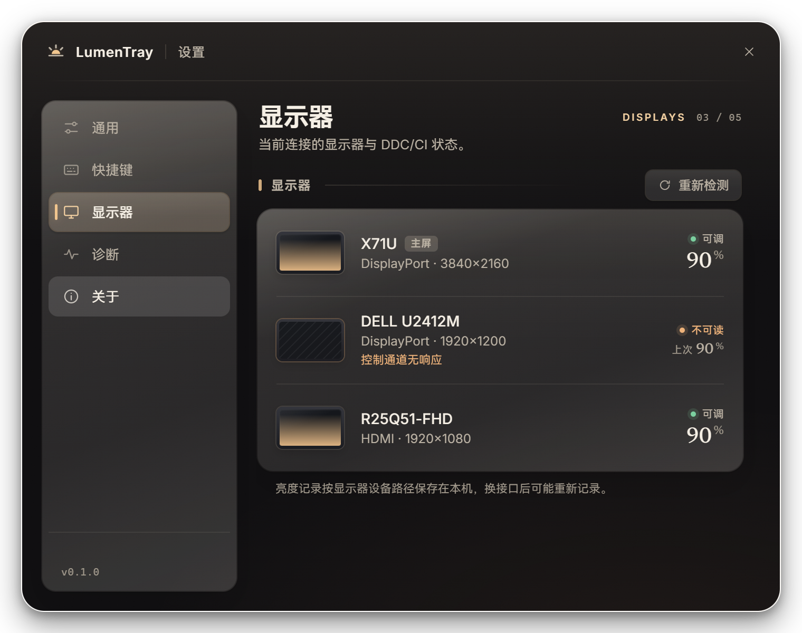
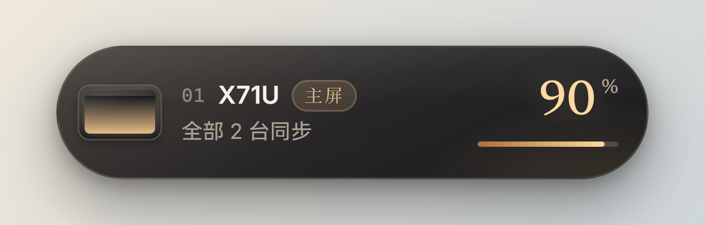

<p align="center">
  
</p>

<h1 align="center">LumenTray</h1>

<p align="center">
  为 <b>Windows 多显示器</b> 打造的亮度托盘应用<br>
  DDC/CI 直连 · 无窗口常驻 · 深浅色玻璃界面
</p>

<p align="center">
  
  
  
  
  
  
  
</p>

<p align="center">
  <a href="https://github.com/Mornstic/lumentray/releases/latest">
    
  </a>
</p>

<p align="center">
  <a href="#界面">界面</a>
  &nbsp;·&nbsp;
  <a href="#使用">使用</a>
  &nbsp;·&nbsp;
  <a href="#快捷键">快捷键</a>
  &nbsp;·&nbsp;
  <a href="#安装">安装</a>
  &nbsp;·&nbsp;
  <a href="#常见问题">常见问题</a>
  &nbsp;·&nbsp;
  <a href="#开发">开发</a>
  &nbsp;·&nbsp;
  <a href="docs/architecture.md">架构详解</a>
  &nbsp;·&nbsp;
  <a href="docs/design-language.md">设计语言</a>
  &nbsp;·&nbsp;
  <a href="CHANGELOG.md">更新记录</a>
</p>

<p align="center">
  <picture>
    <source media="(prefers-color-scheme: dark)" srcset="docs/screenshots/flyout-dark.png">
    
  </picture>
</p>
<p align="center"><sub>飞窗按真实桌面排列显示器；截图跟随 GitHub 深浅主题切换</sub></p>

> 多显示器亮度不该藏在显示器背面的按键里，也不该由一个常驻数百 MB 的主界面来管。LumenTray 只做一条路径：点托盘、拖滑杆、关窗。没有账号、没有云端、没有轮询；关掉窗口后只留一个安静的托盘进程。

> [!NOTE]
> 亮度控制依赖显示器支持 DDC/CI，并在显示器 OSD 中开启。笔记本内屏、部分转接器和扩展坞不转发 DDC/CI，会显示为「不可控」。

## 亮点

| 能力 | 说明 |
|---|---|
| **每屏独立** | 每块物理显示器一条滑杆；编号、名称、接口与真实桌面排列一一对应 |
| **全部联动** | 顶部总控同时调整所有可读写显示器；数值不一致时显示「混合」 |
| **失败可见** | 读取失败的屏幕保留卡片，显示「上次 N%」和原因；其他屏幕不受影响，3 秒后自动重读一次，也可手动重试 |
| **无窗口常驻** | 启动只创建托盘；飞窗和设置窗按需创建、关闭即销毁，后台不保留 WebView2 |
| **事件驱动** | 显示拓扑、设备节点、睡眠唤醒都通过 Win32 事件触发刷新，不做常驻轮询 |
| **全局快捷键** | `Alt` + `F1` / `F2` 调高、调低所有屏幕，默认关闭；调节时在鼠标所在屏显示 OSD |
| **恢复亮度** | 可选在启动和唤醒后恢复每台显示器上次记录的亮度，默认关闭 |
| **玻璃外观** | 暖石墨玻璃 + 象牙光强调色；跟随系统深浅色，可调玻璃不透明度 |
| **诊断完整** | 每屏设备路径、DDC 方法、错误码、日志尾部，一键复制报告；仓库附带 `ddcctl` 诊断 CLI |
| **完全本地** | 不联网、无遥测、无需管理员权限；亮度通过 DDC/CI 直接写入显示器 |

## 界面

飞窗不是系统控件的拼装：显示器光图按真实分辨率与相对位置排布，屏幕里的暖光跟随该屏亮度变化；滑杆、开关、状态圆点与读数都单独绘制。读数使用衬线数字与上标百分号，标签和说明保持无衬线，路径与错误码使用等宽字体。

<p align="center">
  
  
</p>
<p align="center"><sub>左：通用设置与外观 · 右：显示器状态与重新检测</sub></p>

设置窗口分为通用、快捷键、显示器、诊断、关于五页。修改即时生效：主题与玻璃不透明度立刻预览，开机启动直接写入当前用户注册表，快捷键重新注册后才离开录制状态。

<p align="center">
  
</p>
<p align="center"><sub>快捷键调节时，在鼠标所在显示器顶部显示 1.6 秒的 OSD 胶囊</sub></p>

OSD 不抢焦点、不进任务栏和 `Alt` + `Tab`、鼠标可穿透；显示器无响应时读数显示「—」，并提示实际同步了几台。

## 使用

### 托盘与滑杆

- 左键单击托盘图标：打开或收起亮度飞窗
- 右键单击托盘图标：打开亮度、设置、重新检测显示器、退出
- 拖动单屏滑杆：只写该显示器；拖动总控：写入所有当前可读写的显示器
- 滑杆聚焦后可用键盘调整：方向键按设置的步长（1% / 5% / 10%）调节，`PgUp` / `PgDn` 固定 10%，`Home` / `End` 到 0 / 100
- 按 `Esc` 或点击飞窗外部关闭飞窗；飞窗关闭后程序仍在托盘运行
- 某块屏不可控时，卡片上的「重试」会重新枚举并读取该屏，不影响其他屏幕

### 设置页

| 页面 | 内容 |
|---|---|
| 通用 | 开机启动、启动与唤醒恢复亮度、主题（跟随系统 / 浅色 / 深色）、玻璃不透明度、键盘步长 |
| 快捷键 | 全局快捷键总开关、调高 / 调低组合键录制、快捷键步长 |
| 显示器 | 当前连接的显示器、连接方式、DDC/CI 状态与亮度、重新检测 |
| 诊断 | 程序与配置路径、快捷键状态、每屏详情、日志尾部、复制诊断报告 |
| 关于 | 版本、配置路径、已记录显示器数量、隐私说明与项目链接 |

## 快捷键

| 动作 | 默认组合键 |
|---|---|
| 所有显示器亮度增加 | `Alt` + `F1` |
| 所有显示器亮度降低 | `Alt` + `F2` |

全局快捷键默认关闭，避免与其它软件冲突。在「设置 → 快捷键」打开总开关后才会注册；组合键可点击键帽重新录制，必须包含至少一个修饰键，调高与调低不能相同。被其他程序占用时会直接显示原因。

快捷键只调整当前可读写的显示器；不可控屏幕会被跳过并写入日志。调节结果会同步到已经打开的飞窗，并在鼠标所在屏幕显示 OSD。

## 安装

支持 Windows 10 / 11（x64），需要 WebView2 运行时（Windows 11 已自带）。安装版按当前用户安装，不需要管理员权限。

### 下载安装

从 [Releases](https://github.com/Mornstic/lumentray/releases/latest) 页面下载：

| 文件 | 说明 |
|---|---|
| `LumenTray_<version>_x64-setup.exe` | 推荐；按当前用户安装，装完自动驻留托盘 |
| `LumenTray_<version>_x64-portable.zip` | 免安装；解压后直接运行 `lumentray.exe` |
| `SHA256SUMS.txt` | 安装包与便携包的 SHA-256 校验和 |

### 校验下载

下载后可在 PowerShell 中核对 SHA-256：

```powershell
Get-FileHash .\LumenTray_<version>_x64-setup.exe -Algorithm SHA256
```

> [!WARNING]
> 安装包暂未做代码签名，Windows SmartScreen 可能提示「未知发布者」。
> 请从本仓库 Releases 下载并核对 SHA-256 后，再选择「更多信息 → 仍要运行」。

### 从源码构建

前置：Windows 10 / 11、Rust stable（MSVC）、Visual Studio C++ 生成工具、Node.js 20+、WebView2 运行时。

```powershell
git clone https://github.com/Mornstic/lumentray.git
cd lumentray/app
npm install
npm run tauri build
```

产物：

- 安装包 `app/src-tauri/target/release/bundle/nsis/LumenTray_<version>_x64-setup.exe`
- 可执行文件 `app/src-tauri/target/release/lumentray.exe`

生成发布资产（ASCII 命名的安装包、免安装 ZIP 与校验和）：

```powershell
powershell -ExecutionPolicy Bypass -File tools\package_release.ps1
```

文件会输出到 `app/src-tauri/target/release/release-assets/`。

> [!IMPORTANT]
> 必须使用 `npm run tauri build`。直接执行 `cargo build --release` 不会启用 `tauri/custom-protocol`，产物会以开发模式加载 `http://localhost:1420`。
> 正确的发布产物加载的是 `http://tauri.localhost`。

## 常见问题

**支持哪些显示器？**
任何实现 DDC/CI 亮度控制（VCP `0x10`）的物理显示器，通过 DisplayPort、HDMI 或 DVI 连接均可。笔记本内屏通常不实现该 VCP；虚拟显示器、远程桌面和部分采集卡会被自动跳过。部分转接器、KVM 和扩展坞不转发 DDC/CI，此时系统能看到屏幕但无法控制亮度。

**某块屏显示「不可控 / 上次 90%」怎么办？**
这说明当前读取失败，界面显示的是上一次成功记录的值，不会拿旧值冒充当前亮度。先点击「重试」；仍然失败时拔掉显示器电源线等 30 秒再通电（按电源键待机不算断电），并检查显示器 OSD 中是否开启 DDC/CI。部分 Dell 机型在 DDC 通道卡死后只有真正断电才能恢复，错误码通常为 `0xC0262582`；重启电脑或重启显卡驱动都无法替代这一步。

**为什么打开飞窗时先看到旧数值？**
飞窗会先用进程内快照立即渲染，再在后台重新读取。快照保证打开不空白，后台结果会覆盖为显示器的真实值；读取失败则回退到「上次」语义。

**点「全部」会把不可控的屏幕也改掉吗？**
不会。总控只写入当前可读写的显示器；不可控屏幕保持原状，并在卡片上显示原因。

**快捷键没有反应？**
全局快捷键默认关闭，请先在设置中打开总开关；确认组合键没有被其它程序占用。录制时会临时注销现有热键，`Esc` 取消。

**托盘里找不到图标？**
Windows 11 会把新图标折叠进任务栏的 `^` 溢出区，把它拖到任务栏上即可常驻。

**关闭飞窗后程序还在运行吗？**
在。关闭飞窗会销毁窗口并释放 WebView2 进程，只保留托盘主进程；再次打开时按需重建，通常几百毫秒内出现。需要完全退出时使用托盘右键菜单的「退出」。

**设置和亮度记录保存在哪里？**
设置保存在 `%APPDATA%\LumenTray\settings.json`，日志保存在 `%APPDATA%\LumenTray\logs\`；设置页的「诊断」可以直接查看并复制这些路径。

**支持对比度、色温、输入源或 HDR 吗？**
当前版本只做亮度这一条路径，其它 DDC/CI 能力尚未提供界面。

**收费吗？**
不收费。LumenTray 以 MIT 协议开源，没有账号、内购或云服务，也可以自行构建和分发。

**会自动更新吗？**
当前版本不包含自动更新。新版本请从 Releases 下载覆盖安装，设置、亮度记录与开机启动配置会保留。

**会上传数据吗？**
不会。LumenTray 不包含网络代码，不访问云端，也没有遥测。

**安装时提示「未知发布者」？**
当前安装包暂未做代码签名，SmartScreen 可能给出提示。可在 Releases 中下载 `SHA256SUMS.txt` 核对安装包，再选择「更多信息 → 仍要运行」。

## 隐私与安全

- 不联网、不上传、无遥测；亮度通过 Windows Dxva2 / DDC/CI 直接写入显示器
- 仅当用户开启「开机启动」时才写入 `HKCU\Software\Microsoft\Windows\CurrentVersion\Run`
- 设置与亮度记录保存在 `%APPDATA%\LumenTray\settings.json`，日志保存在 `%APPDATA%\LumenTray\logs\`
- 不需要管理员权限，不修改系统主题，不读取屏幕内容
- 安装包当前未签名；请从官方 Releases 下载并校验 SHA-256
- 安全漏洞请按 [SECURITY.md](SECURITY.md) 私下报告

## 架构

```text
LumenTray/
├─ .github/                   CI / Release 工作流、Issue / PR 模板与 CODEOWNERS
├─ app/                       Tauri 2 应用
│  ├─ src/                    React 19 界面：飞窗、设置、OSD
│  ├─ src/assets/fonts/       随包字体与 OFL 许可
│  ├─ src-tauri/              Rust 后端、托盘、窗口与打包配置
│  └─ package.json
├─ crates/ddc-core/           显示器枚举、DDC/CI 读写与错误分类
├─ tools/
│  ├─ ddcctl/                 终端诊断 CLI
│  ├─ cdp-check.mjs           WebView2 调试：状态、截图与后端往返
│  ├─ cdp-eval.mjs            WebView2 调试：在运行页面中执行 JS
│  ├─ cdp.mjs                 CDP 连接辅助
│  └─ package_release.ps1     发布资产打包与校验
├─ docs/
│  ├─ architecture.md         进程模型、枚举、DDC 策略与数据流
│  ├─ design-language.md      材质、字体、读数系统与窗口规格
│  └─ screenshots/            README 截图
├─ CHANGELOG.md
├─ CONTRIBUTING.md
├─ CODE_OF_CONDUCT.md
├─ SECURITY.md
├─ LICENSE
└─ README.md
```

| 模块 | 职责 |
|---|---|
| `crates/ddc-core/src/lib.rs` | `QueryDisplayConfig` 枚举、物理显示器匹配、高层 API 与 VCP `0x10` 回退、进程级串行化、瞬态重试、范围缓存、写入回读 |
| `app/src-tauri/src/lib.rs` | Tauri 启动、托盘、隐藏事件窗口、飞窗与设置窗生命周期、亮度命令 |
| `app/src-tauri/src/cache.rs` | 进程内亮度快照与已记录值，供飞窗水合和快捷键使用 |
| `app/src-tauri/src/hotkeys.rs` | `RegisterHotKey`、组合键解析与录制、80 ms 合并、OSD 联动 |
| `app/src-tauri/src/osd.rs` | 无焦点 OSD 窗口、屏幕定位、淡出与回收 |
| `app/src-tauri/src/settings.rs` | 设置校验、原子写、亮度记录、开机启动状态同步 |
| `app/src-tauri/src/autostart.rs` | `HKCU\...\Run` 与 `StartupApproved` 读写 |
| `app/src-tauri/src/diagnostics.rs` | 诊断信息、日志尾部、复制报告 |
| `app/src-tauri/src/logging.rs` | 2 MB × 3 滚动日志与 400 行环形缓冲 |
| `app/src/App.tsx` | 飞窗：光图、总控、单屏滑杆、失败回滚与自适应高度 |
| `app/src/Settings.tsx` | 五页设置、快捷键录制、诊断报告与关于 |
| `app/src/Osd.tsx` | OSD 胶囊读数与进度条 |
| `tools/ddcctl` | `list` / `get` / `set` / `report` / `bench`，支持 JSON 与计时 |

完整的进程模型、枚举与写入路径见 [`docs/architecture.md`](docs/architecture.md)；
材质层级、字体角色与窗口规格见 [`docs/design-language.md`](docs/design-language.md)。

## 开发

```powershell
cd app
npm install
npm run tauri dev
```

无窗口验证时可用以下调试环境变量（仅 debug 构建生效）：

| 变量 | 作用 |
|---|---|
| `LUMENTRAY_SHOW_ON_START=1` | 启动后自动打开飞窗 |
| `LUMENTRAY_NO_AUTOCLOSE=1` | 飞窗失焦不自动关闭 |
| `LUMENTRAY_SIMULATE_ERROR=one\|all\|empty` | 模拟单屏 / 全部失败或无显示器 |
| `LUMENTRAY_SIMULATE_WRITE_ERROR=1` | 模拟写入失败（仍回读真实值） |
| `LUMENTRAY_RESTORE_NOW=1` | 忽略设置强制执行一次启动恢复 |
| `LUMENTRAY_OSD_HOLD=1` | 让 OSD 保持 600 秒便于截图 |

代码检查：

```powershell
cargo fmt --manifest-path app/src-tauri/Cargo.toml --all -- --check
cargo clippy --manifest-path app/src-tauri/Cargo.toml --all-targets -- -D warnings
cargo test --manifest-path app/src-tauri/Cargo.toml

cargo fmt --manifest-path crates/ddc-core/Cargo.toml --all -- --check
cargo clippy --manifest-path crates/ddc-core/Cargo.toml --all-targets -- -D warnings
cargo test --manifest-path crates/ddc-core/Cargo.toml

cargo fmt --manifest-path tools/ddcctl/Cargo.toml --all -- --check
cargo clippy --manifest-path tools/ddcctl/Cargo.toml --all-targets -- -D warnings
```

前端类型检查与构建：

```powershell
cd app
npm run build
```

GitHub Actions 在 Windows runner 上执行同样的格式、Clippy、测试和前端构建检查，
配置见 [`.github/workflows/ci.yml`](.github/workflows/ci.yml)。

DDC 诊断 CLI：

```powershell
cd tools/ddcctl
cargo run -- list
cargo run -- get DISPLAY1      # 目标可用序号、DISPLAY1、显示器 ID、型号关键字或 primary
cargo run -- set 2 80          # 序号 2 设为 80%，写入后回读校验
cargo run -- report            # 所有显示器状态汇总，适合贴进问题报告
cargo run -- bench             # 同值连写 5 次，查看枚举与稳态写入耗时
```

## 贡献

欢迎提交 Issue 和 Pull Request。开始前请阅读 [CONTRIBUTING.md](CONTRIBUTING.md)；
参与讨论即表示同意遵守 [CODE_OF_CONDUCT.md](CODE_OF_CONDUCT.md)。

- Bug 报告请使用仓库的 Issue 模板，附上 Windows 版本、程序版本、显示器型号、连接方式和诊断报告
- 安全漏洞请按 [SECURITY.md](SECURITY.md) 私下报告，不要在公开 Issue 中粘贴完整设备路径之外的个人信息
- 新功能请先开 Issue 说明使用场景；当前版本的范围有意收在亮度控制

## 版本

当前版本 **v0.1.0**，遵循[语义化版本](https://semver.org/lang/zh-CN/)。每个版本的变更见 [`CHANGELOG.md`](CHANGELOG.md)。

## 文档

| 文档 | 内容 |
|---|---|
| [架构详解](docs/architecture.md) | 进程模型、显示器枚举、DDC/CI 策略与数据流 |
| [设计语言](docs/design-language.md) | 材质、字体、读数系统与窗口规格 |
| [贡献指南](CONTRIBUTING.md) | 开发环境、代码约定与发布流程 |
| [安全策略](SECURITY.md) | 漏洞报告方式与安全边界 |
| [更新记录](CHANGELOG.md) | 版本历史与重要变更 |

## 许可证

LumenTray 以 [MIT License](LICENSE) 开源，Copyright (c) 2026 Mornstic。

随包字体 Inter、Newsreader、Noto Sans SC 按 SIL Open Font License 1.1 分发，
许可见 [`app/src/assets/fonts/`](app/src/assets/fonts/)。

## 致谢

- [Tauri](https://tauri.app/) 与 [Rust](https://www.rust-lang.org/) 提供了轻量的桌面运行时
- [`windows`](https://github.com/microsoft/windows-rs) crate 让 Win32 / Dxva2 调用可以直接写在 Rust 里
- [Twinkle Tray](https://github.com/xanderfrangos/twinkle-tray) 展示了多显示器亮度工具的完整形态，也促使我们重新审视枚举与 DDC/CI 容错
- Inter、Newsreader、Noto Sans SC 的字体作者与 OFL 社区
- 所有提交 Issue、反馈使用体验和帮助测试的朋友

<p align="center"><sub>如果这个项目让你的桌面更舒服一点，欢迎点一个 Star。</sub></p>
